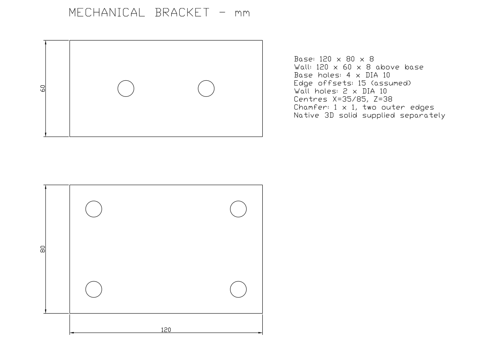

# AutoCAD Automation MCP + Skill

> 源码审查与可复现说明：见 [2026-11-24 源码审查报告](docs/SOURCE-AUDIT.md)。本项目提供可读源码和本地构建流程，采用 [MIT 许可证](LICENSE)。
**用 AI Agent 操作 AutoCAD，完成二维制图、三维建模、检查修改和文件交付。**

你描述尺寸和结构，AI 制定建模计划，通过 MCP 调用本机 AutoCAD 的真实接口，创建可编辑的原生图形与实体，检查结果并保存 DWG、DXF、PDF、STL。

自然语言理解由 Codex 等 AI 客户端完成。本项目提供 MCP 工具、计划执行器和建模 Skill，不需要额外配置一个模型 API。

## 能做什么

- 二维：直线、圆、圆弧、矩形、多段线、样条、填充、偏移、修剪、镜像、阵列及两直线圆角/倒角。
- 三维：基本实体、拉伸、旋转成型、扫描、放样、布尔运算、剖切、抽壳、圆角、倒角及位置变换。
- 图纸：原生尺寸标注、文字、图层、线型、线宽、颜色和块。
- 检查：读取尺寸、体积、包围盒、实体数量；检查孔位和干涉，识别部分重复图形。
- 恢复：修改前保存恢复点，失败保留回执，支持有限修复和步骤间取消。
- 交付：DWG、DXF、PDF、STL、截图和真实桌面测试录像。

共 **93 个 MCP 工具**。完整参数见 [工具清单](docs/tool-manifest.json)，支持范围见 [能力说明](docs/CAPABILITIES.zh-CN.md)。

## 安装条件

| 软件 | 要求 |
|---|---|
| 操作系统 | Windows 64 位 |
| AutoCAD | 完整版 AutoCAD 2026，能正常启动并已完成许可激活 |
| Node.js | 20 或以上；开发测试版本 24.15 |
| Python | 3.11 或以上；开发测试版本 3.13 |
| .NET SDK | .NET 8 SDK，用于编译 AutoCAD 桥接插件 |
| Codex | 已安装，命令行可执行 `codex` |
| FFmpeg | 需要录屏时安装，并将 `ffmpeg.exe` 加入 PATH |

不支持 AutoCAD LT、Mac 或其他 CAD 软件。AutoCAD 与 FFmpeg 需自行安装；不分发 Autodesk DLL。

## 快速安装

先启动 AutoCAD，完成首次启动和许可证提示。在 PowerShell 中执行：

```powershell
git clone https://github.com/jackmaikr4-sketch/AutoCAD-automation-mcp-skill.git
cd AutoCAD-automation-mcp-skill
./scripts/install.ps1 -AutoCADDir 'C:/Program Files/Autodesk/AutoCAD 2026'
```

如果 AutoCAD 安装在其他目录，修改 `-AutoCADDir`。安装脚本会安装 Node/Python 依赖、编译桥接插件、备份已有 Codex 配置，然后添加 `autocad-ai-mcp` 和建模 Skill。

**安装后重新加载 Codex 的 MCP 连接，或者新建聊天。** 不要删除或移动项目目录，服务会从该目录启动。

如果 FFmpeg 不在 PATH 中，在 Codex 配置的 `[mcp_servers.autocad-ai-mcp.env]` 中增加：

```toml
AICAD_FFMPEG = 'D:\ffmpeg\bin\ffmpeg.exe'
```

`AICAD_PYTHON` 指向安装了 pywin32、Pillow 的 Python；安装脚本会自动写入。安装过程不会自动下载或激活 AutoCAD。

## 直接对 AI 说

> 使用 AutoCAD 绘制一块 120×80×8 mm 的底板，四角各开一个直径 10 mm 的通孔，孔中心距相邻边 12 mm。先录屏，再建模，检查尺寸和孔位，保存 DWG 并导出 STL。

> 把孔径改成 12 mm。修改前保存恢复点，修改后检查实体，另存一个新版本。

> 绘制 100×60 mm 的矩形板轮廓，在中心画一个直径 20 mm 的圆孔，添加尺寸标注，输出 DWG 和 PDF。

默认单位是毫米。关键尺寸不全时，AI 应先询问；采用非关键假设时应明确说明。建模期间保持 AutoCAD 可见，测试录屏期间不要同时操作画布。

文件输出到项目 `output` 目录，录像、恢复点和日志保存到 `artifacts`。文件操作限定在这两个目录；修改外部 DWG 时，先复制到 `output`，保留原稿。默认拒绝覆盖现有输出。

## 已验证的机械支架示例



- 底板 120×80×8 mm；支撑板宽 120、厚 8、净高 60 mm，整体尺寸 120×80×68 mm。
- 底板四孔、支撑板两孔，均为直径 10 mm；两个外侧边采用 1 mm 倒角。
- 最终为一个原生三维实体；六孔经过独立干涉检查；DWG 保存并重新打开后再次检查。
- 示例孔位等未指定尺寸采用了明确假设，详见 [验收说明](docs/ACCEPTANCE.zh-CN.md)。

下载：[原生 DWG](examples/bracket/mechanical-bracket.dwg) · [STL](examples/bracket/mechanical-bracket.stl) · [DXF](examples/bracket/mechanical-bracket.dxf) · [尺寸图 PDF](examples/bracket/dimension-sheet.pdf) · [二维 DWG](examples/bracket/dimension-sheet.dwg)

本机验收中，完整工具回归 107 次调用无失败；组合测试覆盖全部 93 个工具，包含错误处理、修复、取消与撤销。截图和录像在真实 AutoCAD 中生成，桌面录像及运行日志默认不上传到仓库。

## 测试

```powershell
npm test
node scripts/test-tools.mjs
node scripts/test-recovery.mjs
node scripts/acceptance-bracket.mjs
```

`npm test` 仅检查参数规则。其他脚本会实际操作 AutoCAD、新建测试图纸并录屏，需要安装 FFmpeg。测试完成后查看脚本退出码与生成的回执；不要把模拟数据当成真实验收。最终算例文件位置写入 `artifacts/final-delivery.json`。

若需额外解析 PDF/STL/录像，安装 `pip install PyMuPDF`，确保 ffprobe 在 PATH，然后运行 `python scripts/verify-delivery.py`。

## 其他 MCP 客户端

```json
{
  "mcpServers": {
    "autocad-ai-mcp": {
      "command": "node",
      "args": ["D:/your-project/AutoCAD-automation-mcp-skill/src/server.mjs"],
      "env": {"AICAD_PYTHON": "python", "AICAD_FFMPEG": "D:/ffmpeg/bin/ffmpeg.exe"}
    }
  }
}
```

把路径替换成实际位置，并向 AI 提供 [建模 Skill](skill/SKILL.md) 中的工作流程；手动使用时将其中 `__PROJECT_ROOT__` 替换为项目路径。建议工具超时设为 600 秒。

## 常见问题和边界

- **工具未出现：**检查 `codex mcp get autocad-ai-mcp`，重新加载连接或新开聊天。
- **AutoCAD 忙碌：**处理对话框或未完成命令后先检查图纸，再继续；不要盲目重发修改操作。
- **插件无法重新编译：**保存工作并关闭 AutoCAD 后再编译，已加载 DLL 可能被锁定。
- **导出 PDF 弹出选择应用：**关闭系统窗口，或在 AutoCAD PDF 选项中关闭“显示结果”。
- **恢复模型：**打开 `artifacts/checkpoints` 中的 DWG，检查后另存为新版本。多步骤失败不会自动撤销先前成功的步骤。
- **能力边界：**原生实体可以编辑，但不是完整机械参数化特征树。复杂曲面和特殊拓扑可能失败，修复范围有限。只允许一个客户端同时控制当前 AutoCAD。

## 代码结构

| 目录 | 内容 |
|---|---|
| `src` | 官方 MCP SDK 服务、工具参数、COM 工作者和录屏 |
| `bridge` | AutoCAD .NET 原生几何桥接插件 |
| `skill` | AI 规划、执行、检查与交付流程 |
| `scripts` | 安装、注册、真实测试及文件核验 |
| `docs` | 工具清单、能力范围和验收说明 |
| `examples` | 已生成的原生示例文件 |

仓库不包含 AutoCAD 安装程序、许可证、账号信息、Python/Node 依赖目录或本机 Codex 配置。

## 环境诊断

运行 `npm run doctor -- "C:/Program Files/Autodesk/AutoCAD 2026"` 检查安装文件、Python/COM、.NET 8 SDK 和录屏工具。路径也可通过 `AICAD_AUTOCAD_DIR` 指定。该命令不会启动 AutoCAD，检查不通过返回非零退出码；旧版 AutoCAD 不能替代本项目的 2026 接口。当前测试机 2026 安装已缺失，详见本轮源码审查报告。
